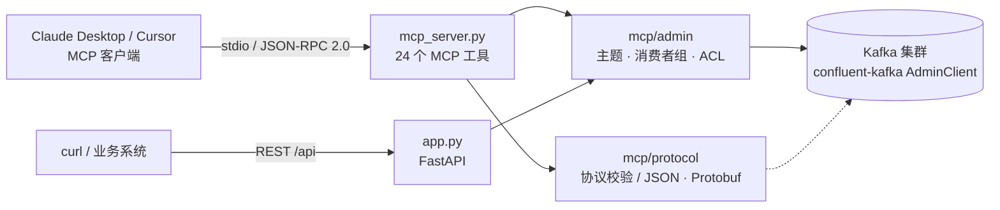

# Kafka MCP Server

> 让 Claude、Cursor 等 MCP 客户端直接管理 Kafka：一处注册模型，自动创建主题、绑定版本、配置 ACL，并监控消费滞后。

[](https://www.python.org/)
[](LICENSE)
[](https://modelcontextprotocol.io/)

Kafka MCP Server 把 Kafka Admin Client 封装成一组 MCP 工具（stdio + JSON-RPC 2.0），
同时提供等价的 FastAPI HTTP 接口。它围绕「模型 ↔ 主题」这一层抽象做文章：
模型注册时自动创建主题，版本迭代时自动创建隔离主题，权限、消费者组、滞后监控都按
「模型 + 版本」维度管理，不需要在 LLM 对话里手写一长串 `kafka-topics.sh` 命令。

## 架构与运行效果



MCP stdio 通道的一次真实交互（`initialize` → `tools/list` 的返回片段）：

```text
$ echo '{"jsonrpc":"2.0","id":1,"method":"initialize","params":{"protocolVersion":"2024-11-05","capabilities":{}}}' | python mcp_server.py
{"jsonrpc":"2.0","id":1,"result":{"protocolVersion":"2024-11-05",
 "capabilities":{"tools":{"listChanged":false}},
 "serverInfo":{"name":"kafka-mcp","version":"1.0.0"}}}
```

```text
$ curl -s http://localhost:8000/health
{"status":"ok"}
```

## Quick Start

```bash
# 1) 获取代码
git clone https://github.com/YOUR_NAME/kafka-mcp.git && cd kafka-mcp

# 2) 安装依赖（建议 Python 3.9+ 的虚拟环境）
pip install -r requirements.txt

# 3) 配置 Kafka 连接信息（.env 已被 .gitignore 忽略）
cp .env.example .env && ${EDITOR:-vi} .env

# 4) 启动 HTTP API（可选；MCP 客户端走 stdio，不依赖它）
python app.py          # Swagger UI: http://localhost:8000/docs

# 5) 自测 MCP stdio 通道
echo '{"jsonrpc":"2.0","id":1,"method":"tools/list"}' | python mcp_server.py
```

## 在 MCP 客户端中接入

MCP 客户端通过 `command` + `args` + `env` 拉起 `mcp_server.py`，与环境变量配置方式完全兼容。

### Claude Desktop

配置文件位置：

- macOS：`~/Library/Application Support/Claude/claude_desktop_config.json`
- Windows：`%APPDATA%\Claude\claude_desktop_config.json`

```json
{
  "mcpServers": {
    "kafka": {
      "command": "/usr/bin/python3",
      "args": ["/Users/you/Code/kafka-mcp/mcp_server.py"],
      "env": {
        "KAFKA_BOOTSTRAP_SERVERS": "localhost:9092",
        "KAFKA_SECURITY_PROTOCOL": "SASL_SSL",
        "KAFKA_SASL_MECHANISM": "PLAIN",
        "KAFKA_SASL_USERNAME": "your-username",
        "KAFKA_SASL_PASSWORD": "your-password",
        "LOG_LEVEL": "INFO"
      }
    }
  }
}
```

要点：

- `command` 指向**已经装好 requirements 的 Python**（虚拟环境请用 `.venv/bin/python` 绝对路径）
- `args` 使用 `mcp_server.py` 的**绝对路径**，避免依赖启动目录
- `env` 优先级高于项目内 `.env`；SASL 凭据建议只放这里，不要提交到仓库
- stdio 模式下 stdout 专用于协议帧，日志全部输出到 stderr
- 保存后重启客户端，工具列表中应出现 **24 个 Kafka 工具**

### Cursor

`~/.cursor/mcp.json`（或项目内 `.cursor/mcp.json`）使用相同结构：

```json
{
  "mcpServers": {
    "kafka": {
      "command": "/Users/you/Code/kafka-mcp/.venv/bin/python",
      "args": ["/Users/you/Code/kafka-mcp/mcp_server.py"],
      "env": {"KAFKA_BOOTSTRAP_SERVERS": "localhost:9092"}
    }
  }
}
```

其他支持 stdio transport 的 MCP 客户端，同样使用上面的 `command` / `args` / `env` 三段配置。

## 核心特性

- **模型 ↔ 主题动态绑定**：注册模型时按 `MODEL_TOPIC_PREFIX + model_id + .v + version` 自动建主题，支持自定义分区、副本、保留策略
- **主题生命周期管理**：创建 / 删除 / 列出主题，读取与修改任意主题配置
- **版本隔离与回滚**：每个版本独立主题，切换默认版本即可完成版本切换 / 回滚
- **ACL 权限管理**：按主体（User/Group）或按角色（`admin` / `producer` / `consumer`）授权，支持查询与回收
- **协议校验与序列化**：校验 `model_id` / `version` / `content` 等字段规范，支持 JSON 与 Protobuf 序列化
- **消费者组观测**：列出消费者组、查询提交偏移量、计算 Lag 摘要（ok / warning / critical）
- **消息投递**：`model_publish` 把一条符合 MCP 规范的消息写入模型版本对应主题
- **双入口**：同一套 Kafka 管理能力同时暴露为 MCP 工具与 REST API

## MCP 工具清单

共 24 个工具，全部来自 `mcp_server.py`（底层调用 `mcp/admin/` 中的管理器）。带 `*` 为必填参数。

### 集群与主题

| 工具 | 说明 | 参数 |
| --- | --- | --- |
| `kafka_cluster_metadata` | 获取集群元数据：集群 ID、Controller、Broker 列表、主题概览 | — |
| `kafka_list_topics` | 列出所有主题及分区信息 | — |
| `kafka_create_topic` | 创建主题（可指定分区数、副本因子、主题配置） | `*topic`, `num_partitions`, `replication_factor`, `config` |
| `kafka_delete_topic` | 删除主题（不可恢复） | `*topic` |
| `kafka_get_topic_config` | 读取主题全部配置项 | `*topic` |
| `kafka_set_topic_config` | 修改主题配置，如 `retention.ms`、`cleanup.policy` | `*topic`, `*config` |

### 消费者组

| 工具 | 说明 | 参数 |
| --- | --- | --- |
| `kafka_list_consumer_groups` | 列出消费者组，可按前缀过滤 | `prefix` |
| `kafka_get_group_offsets` | 查询组提交偏移量 `{topic: {partition: offset}}` | `*group_id`, `topic` |
| `kafka_get_consumer_lag` | 查询组在模型版本主题上的 Lag 摘要 | `*group_id`, `*model_id`, `*version` |
| `kafka_reset_consumer_offsets` | 重置组偏移量（`earliest` / `latest`） | `*group_id`, `*model_id`, `*version`, `offset` |

### 模型与版本

| 工具 | 说明 | 参数 |
| --- | --- | --- |
| `model_register` | 注册模型并创建初始版本主题 | `*model_id`, `*name`, `*version`, `description`, `partitions`, `replication_factor`, `retention_ms`, `metadata` |
| `model_list` | 列出当前进程中已注册的模型 | — |
| `model_get` | 获取模型详情（含版本列表、默认版本） | `*model_id` |
| `model_delete` | 删除模型及其全部版本主题 | `*model_id` |
| `model_version_create` | 新建版本并创建隔离主题 | `*model_id`, `*version`, `partitions`, `replication_factor`, `retention_ms`, `metadata` |
| `model_version_list` | 列出模型全部版本 | `*model_id` |
| `model_version_delete` | 删除版本及其主题 | `*model_id`, `*version` |
| `model_set_default_version` | 设置默认版本（版本切换 / 回滚） | `*model_id`, `*version` |

### 消息与协议

| 工具 | 说明 | 参数 |
| --- | --- | --- |
| `model_publish` | 向模型版本主题投递一条 MCP 消息 | `*model_id`, `*version`, `*content`, `content_type`, `metadata` |
| `mcp_validate_message` | 校验消息是否符合 MCP 协议规范 | `*message` |

### ACL

| 工具 | 说明 | 参数 |
| --- | --- | --- |
| `model_acl_create` | 为模型版本主题创建 ACL | `*model_id`, `*version`, `*principal`, `*operations`, `allow` |
| `model_acl_list` | 列出模型版本主题的 ACL | `*model_id`, `*version` |
| `model_acl_delete` | 删除 ACL；不传 `principal` 时删除全部 | `*model_id`, `*version`, `principal` |
| `model_acl_create_role` | 按角色授权（`admin` / `producer` / `consumer`） | `*model_id`, `*version`, `*role` |

## HTTP API 清单

服务默认监听 `http://localhost:8000`，完整字段说明见 [docs/api.md](docs/api.md)，启动后也可访问 `/docs`。

| 方法 | 路径 | 说明 |
| --- | --- | --- |
| GET | `/` | 服务欢迎信息 |
| GET | `/health` | 健康检查 |
| POST | `/api/models` | 注册模型并创建初始版本主题 |
| GET | `/api/models` | 列出全部模型 |
| GET | `/api/models/{model_id}` | 查询单个模型 |
| DELETE | `/api/models/{model_id}` | 删除模型及其全部版本主题 |
| POST | `/api/models/{model_id}/versions` | 创建模型新版本 |
| GET | `/api/models/{model_id}/versions` | 列出模型全部版本 |
| GET | `/api/models/{model_id}/versions/{version}` | 查询单个版本 |
| DELETE | `/api/models/{model_id}/versions/{version}` | 删除版本及其主题 |
| POST | `/api/models/{model_id}/default-version/{version}` | 设置默认版本 |
| GET | `/api/consumers/{group_id}/lag` | 查询消费者组 Lag 摘要 |
| GET | `/api/admin/cluster/metadata` | 集群元数据 |
| GET | `/api/admin/topics` | 列出主题 |
| POST | `/api/admin/topics` | 创建主题 |
| DELETE | `/api/admin/topics/{topic_name}` | 删除主题 |
| GET | `/api/admin/topics/{topic_name}/config` | 读取主题配置 |
| PUT | `/api/admin/topics/{topic_name}/config` | 更新主题配置 |
| GET | `/api/admin/consumer-groups` | 列出消费者组 |
| GET | `/api/admin/consumer-groups/{group_id}/offsets` | 查询组偏移量 |
| POST | `/api/admin/consumer-groups/{group_id}/reset` | 重置组偏移量 |
| POST | `/api/admin/models/{model_id}/versions/{version}/acl` | 创建 ACL |
| GET | `/api/admin/models/{model_id}/versions/{version}/acl` | 查询 ACL |
| DELETE | `/api/admin/models/{model_id}/versions/{version}/acl` | 删除 ACL |
| POST | `/api/admin/models/{model_id}/versions/{version}/role/{role}` | 按角色授权 |

## 配置说明

所有配置都有默认值，通过环境变量或项目根目录的 `.env` 覆盖（模板见 [.env.example](.env.example)）。
MCP 客户端也可以在 `env` 字段中直接传入。

| 变量 | 默认值 | 说明 |
| --- | --- | --- |
| `KAFKA_BOOTSTRAP_SERVERS` | `localhost:9092` | Kafka 集群地址，多个用逗号分隔 |
| `KAFKA_SECURITY_PROTOCOL` | `PLAINTEXT` | `PLAINTEXT` / `SASL_PLAINTEXT` / `SSL` / `SASL_SSL` |
| `KAFKA_SASL_MECHANISM` | 空 | SASL 机制，如 `PLAIN`、`SCRAM-SHA-256` |
| `KAFKA_SASL_USERNAME` / `KAFKA_SASL_PASSWORD` | 空 | SASL 认证凭据，只从环境读取，不入库 |
| `DEFAULT_TOPIC_PARTITIONS` | `3` | 模型主题默认分区数 |
| `DEFAULT_TOPIC_REPLICATION_FACTOR` | `3` | 模型主题默认副本因子 |
| `DEFAULT_TOPIC_RETENTION_MS` | `604800000` | 默认保留时长（7 天） |
| `MODEL_TOPIC_PREFIX` | `mcp.model.` | 模型主题名前缀 |
| `CONSUMER_GROUP_PREFIX` | `mcp.consumer.` | 消费者组名前缀 |
| `API_HOST` / `API_PORT` | `0.0.0.0` / `8000` | HTTP 服务监听地址 |
| `API_DEBUG` | `false` | 开启 uvicorn reload |
| `LOG_LEVEL` | `INFO` | 日志级别 |
| `DEFAULT_SERIALIZATION_FORMAT` | `json` | 默认序列化格式：`json` / `protobuf` |

## 项目结构

```text
kafka-mcp/
├── app.py                     # HTTP API 入口（FastAPI + uvicorn）
├── mcp_server.py              # MCP stdio 入口（JSON-RPC 2.0，24 个工具）
├── config.py                  # 环境变量配置 + Kafka 安全配置
├── requirements.txt           # 运行依赖
├── requirements-dev.txt       # 测试依赖（pytest）
├── .env.example               # 配置模板
├── docs/
│   └── api.md                 # HTTP API 详细文档
├── mcp/
│   ├── admin/                 # Kafka Admin Client 封装
│   │   ├── kafka_admin.py     # 集群/主题/消费者组底层操作
│   │   ├── topic_manager.py   # 模型主题命名、创建、删除
│   │   ├── consumer_manager.py# 消费者组、偏移量、Lag
│   │   └── acl_manager.py     # ACL 授权与查询
│   ├── api/                   # FastAPI 路由（models_api / admin_api）
│   ├── client/                # MCPProducer / MCPConsumer
│   ├── models/                # Model / ModelVersion / ModelConfig
│   ├── protocol/              # 协议校验与 JSON/Protobuf 序列化
│   └── utils/                 # 日志工具
├── scripts/
│   ├── README.md
│   └── auto_kafka_script.sh   # 可选：Kafka 集群运维辅助脚本（Linux）
└── tests/                     # 单元测试（无需真实 Kafka）
```

## 开发与测试

```bash
pip install -r requirements-dev.txt
pytest tests/ -q
```

测试使用伪 Admin Client 与 FastAPI `TestClient`，**不依赖真实 Kafka 集群**，覆盖：

- `tests/test_protocol.py`：协议校验、JSON 序列化
- `tests/test_admin.py`：模型主题命名、批量创建、删除、配置更新
- `tests/test_api.py`：HTTP 路由与 OpenAPI 冒烟测试
- `tests/test_producer.py`：生产者发送流程（mock）
- `tests/test_mcp_server.py`：MCP 协议层（initialize / tools/list / tools/call / 错误码）

## 已知限制

- **模型注册表在进程内存中**：REST 服务与 MCP stdio 进程各自维护一份，重启后需重新注册；
  Kafka 主题、ACL 等集群侧资源仍然持久。生产环境建议替换为数据库或配置中心。
- **HTTP API 未内置认证 / 限流**：默认监听 `0.0.0.0`，请勿直接暴露到公网，建议放在内网或网关之后。
- **版本回滚只切换默认版本**，不会自动删除旧主题数据，旧数据按主题 retention 策略过期。
- **Protobuf 反序列化需要调用方提供 `message_type`**，仓库内未内置 `.proto` 定义。
- 项目暂无 CI 与演示截图 / GIF。

## License

[MIT](LICENSE) © 2026 WilShi
